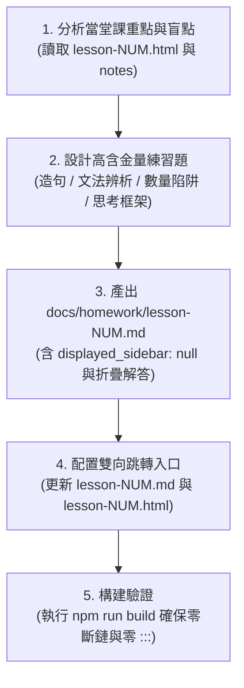

# 韓語課後作業生成 Skill (Korean Homework Generator)

本 Skill 專門用於為指定課堂（例如 `Lesson 12`）量身打造**「深度複習、直擊易錯盲點、拒絕死記硬背」**的專屬課後作業與自我測驗頁面，並嚴格遵循專案的版面獨立性與不引導原則。

---

## 🎯 核心原則與規範 (Core Principles)

1. **獨立放置，絕對不放側邊欄 (No Sidebar)**：
   - 作業檔案統一存放於 **`docs/homework/lesson-{NUM}.md`**（例如 `docs/homework/lesson-012.md`）。
   - Frontmatter 必須包含 **`displayed_sidebar: null`**，使頁面維持乾淨的全寬無干擾介面。
   - 由於 `sidebars.ts` 只自動讀取 `docs/lessons` 與 `docs/reference`，放在 `docs/homework/` **絕對不會出現在左側課程目錄中**，保持課程清單的純粹。

2. **流暢的雙向跳轉機制 (Bi-directional Navigation)**：
   - **Lesson 筆記頁**（`docs/lessons/lesson-{NUM}.md`）：
     - 在「作業與複習」清單中加上超連結：
       ```markdown
       - 作業與複習：
         - [ ] **[📝 Lesson {NUM} 課後重點複習作業](../homework/lesson-{NUM}.md)**
         - [ ] **[👥 Lesson {NUM} 雙人複習手冊 (20分鐘)](../practice/lesson-{NUM}.md)**
       ```
     - 不需加入多餘的 `:::tip` 橫幅卡片，保持頂部排版俐落。
   - **Lesson HTML 頁**（`static/lessons/lesson-{NUM}.html`）：
     - 在結尾區塊提供跳轉按鈕（包含作業與雙人複習手冊）。
   - **Homework 作業頁**（`docs/homework/lesson-{NUM}.md`）：
     - 頁面最底部提供返回課堂與雙人複習連結：
       `🔙 **[返回 Lesson {NUM} 課堂筆記頁面](../lessons/lesson-{NUM}.md)** ｜ 👥 **[前往 Lesson {NUM} 雙人複習手冊 (20分鐘)](../practice/lesson-{NUM}.md)**`

3. **Docusaurus Admonition 語法規範 (嚴格中括號)**：
   - 本專案啟用未來標準規範，**所有提示卡片標題必須用中括號 `[...]` 包覆**，否則會被解析為普通文字並直接印出三個冒號 `:::`：
     - ✅ `:::info[📌 本課複習導覽]`
     - ✅ `:::tip[✍️ 本課專屬課後複習作業]`
     - ✅ `:::note[📝 發表任務自主思考框架]`
     - ✅ `:::caution[⚠️ 經典發音與用字陷阱]`

4. **題型設計哲學：高含金量，拒絕過於簡單的題型**：
   - **不要**出死背單字的純選擇題（例如 `이것이 ➔ ? (A) 이게 (B) 그건`）。
   - **不要**機械式填空，每堂課根據當堂重難點靈活設計 3~5 個大單元。
   - 聚焦於**情境中翻韓造句、對話委婉應對、文法語氣細節辨析、固有詞/漢字詞數量陷阱、代表音與連音**。

5. **課堂口頭發表原則（若當堂有 숙제: 발표）**：
   - **嚴格禁止代寫示範講稿或範例短文**，避免學生的表達思路受到框架限制或引導。
   - **僅提供「自主構思思考維度框架表格」**（例如：1. 開場目的地、2. 交通耗時、3. 天氣景點、4. 美食戰利品、5. 心得致謝），並附上提問提示（언제? 어디에?）與當堂學過的生詞庫，保留空白欄位讓學生自由創作。

6. **側邊大綱欄 (TOC) 防重複規範**：
   - Docusaurus 會自動將頁面中的 `##` 與 `###` 抓取為右側文章大綱目錄（On-page TOC）。
   - **折疊答案區 (`<details>`) 內部嚴禁使用 `##` 或 `###` 標題**，以防答案項重複出現在右側大綱目錄中，導致題目與答案成對重複。
   - 折疊內部的小標題一律使用加粗文字（如 `**【解析 1】...**` 或 `**1. ...**`）。

---

## 🛠️ 標準作業流程 (Workflow)



### 步驟 1：深度分析課堂核心重點與易錯點
檢視該堂課的 HTML 或筆記，挑選出：
- 最具代表性的日常/旅遊實戰問答（如點餐、付款、試穿）。
- 學生最容易搞混的成對文法（如 `-만` vs `-밖에`、`-아/어 보이다` vs `-겠다`）。
- 數量詞陷阱（如小時用固有詞 `두 시간`、天數 `닷새`、月份或金額連音）。
- 易混淆詞彙（如 `질문` vs `문제`、`안내` vs `안내소`）。

### 步驟 2：建立 `docs/homework/lesson-{NUM}.md`
結構範本如下：

```markdown
---
title: Lesson {NUM} 課後複習作業 ✍️
displayed_sidebar: null
---

import { KoreanWord, KoreanAudio } from '@site/src/components/KoreanAudio';

# Lesson {NUM} 課後重點複習作業 ✍️

:::info[📌 本課複習導覽]
* **對應課程**：[Lesson #{NUM} 旅遊韓語會話馬上開口說 ({DATE})](../lessons/lesson-{NUM}.md)
* **設計目標**：跳脫死背，針對本堂課核心文法辨析、數量陷阱、實戰對話應答與易混淆單字進行高效自測。
* **使用方式**：建議先自己動筆或在心中組織句子，完成後再點擊 **「💡 點擊展開參考解析」** 對照盲點。
:::

---

## 一、 實戰情境對話與應答 (中翻韓口說練習)
{結合當堂情境，要求寫出完整且自然的韓語句子，可包含委婉拒絕或點餐交代}

<details>
<summary>💡 點擊展開第一大題參考解析</summary>
{提供標準答案、動詞拆解與母語者慣用思路說明}
</details>

---

## 二、 核心文法精準辨析 (句型原理與語氣差異)
{針對當堂重點對比文法出題，例如：限定接續、感官判斷語尾}

<details>
<summary>💡 點擊展開第二大題參考解析</summary>
{詳細剖析肯定/否定接續規則、語氣強烈程度或外觀vs直覺感嘆的差異}
</details>

---

## 三、 數字、時間量詞與發音陷阱
{針對固有數詞vs漢字數詞、連音或硬音化陷阱出題}

<details>
<summary>💡 點擊展開第三大題參考解析</summary>
{標註正確發音與量詞規則}
</details>

---

## 四、 易混淆詞彙概念辨析
{挑選當堂課相似詞進行語意情境區分}

<details>
<summary>💡 點擊展開第四大題參考解析</summary>
{解析各詞的使用場合與常見搭配詞}
</details>

---

## 五、 本週課堂口頭發表自主構思區 (若有作業：숙제 발표)

:::note[📝 發表任務自主思考框架]
下週課堂作業為口頭發表。為了不限制您的想法與真實經歷，此處不提供制式範文。  
建議您可以沿著以下思考維度，用本堂課學到的單字與句型自行組織您的講稿：
:::

| 構思維度 | 思考提示與可用詞彙 | 您的筆記與發表草稿 |
| :--- | :--- | :--- |
| **1. 開場與主題** | 提示詞彙... |  |
| **2. 細節與過程** | 提示詞彙... |  |
| **3. 心得與感受** | 提示詞彙... |  |

---

🔙 **[返回 Lesson {NUM} 課堂筆記頁面](../lessons/lesson-{NUM}.md)**
```

### 步驟 3：在 Lesson 筆記中建立跳轉連結
在 `docs/lessons/lesson-{NUM}.md` 中加入：
1. 作業清單項目：
   ```markdown
   - [ ] **[📝 Lesson {NUM} 課後重點複習作業 (點此前往)](../homework/lesson-{NUM}.md)**
   ```
2. 頂部提示卡片（**必須用中括號**）：
   ```markdown
   :::tip[✍️ 本課專屬課後複習作業]
   👉 **[點擊前往 Lesson {NUM} 課後重點複習作業 🚀](../homework/lesson-{NUM}.md)**  
   {說明測驗亮點}（附折疊式參考解析）！
   :::
   ```

### 步驟 4：在 Lesson HTML 中加入跳轉按鈕
在 `static/lessons/lesson-{NUM}.html` 適當位置（如結尾作業區）加入：
```html
<div class="mt-4 pt-3 border-t border-indigo-100 flex flex-col sm:flex-row items-center justify-between gap-3">
    <span class="text-xs text-indigo-950 font-medium">✨ 想立即動筆自我測驗或檢核學習盲點嗎？</span>
    <a href="/korean-notes/docs/homework/lesson-{NUM}" target="_parent" class="no-print inline-flex items-center gap-2 px-4 py-2 bg-indigo-600 hover:bg-indigo-700 text-white text-xs sm:text-sm font-bold rounded-lg shadow-sm transition-all">
        <span>📝 前往本課專屬複習作業</span>
        <svg class="w-4 h-4" fill="none" stroke="currentColor" viewBox="0 0 24 24"><path stroke-linecap="round" stroke-linejoin="round" stroke-width="2" d="M14 5l7 7m0 0l-7 7m7-7H3"/></svg>
    </a>
</div>
```

### 步驟 5：構建測試 (Build Verification)
執行以下指令驗證：
```powershell
npm run build
```
確認輸出符合：
- `[SUCCESS] Generated static files in "build".`
- 無任何 `Broken link` 或 `Broken anchor`。
- 檢查 HTML 中無殘留未解析的 `:::` 字串。

