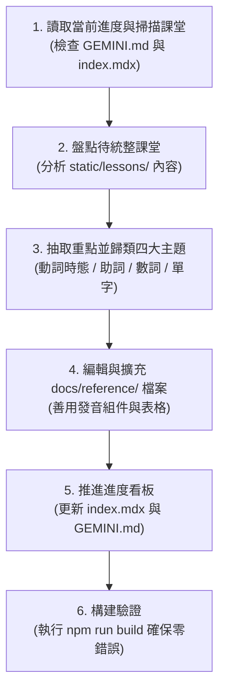

# 韓語文法與單字庫更新統整 Skill (Korean Reference Updater)

本 Skill 專門用於將累積數堂的韓語上課筆記（`static/lessons/lesson-*.html`），**系統化抽取文法、助詞、數詞量詞與情境單字**，擴充至 `docs/reference/` 專題資料庫中，並**同步記錄目前統整至第幾課**。

---

## 🎯 觸發時機 (Trigger Conditions)

當用戶提出以下需求時觸發：
1. 「幫我檢視文法與單字庫需要補哪些內容」
2. 「把最近幾堂課的重點/文法/單字統整進資料庫」
3. 「更新文法與單字庫並推進進度至 Lesson N」
4. 「查看目前文法單字庫統整到第幾課」

---

## 🗺️ 資料庫架構與檔案對應 (Target Files)

| 檔案路徑 | 專題名稱 | 核心收錄範疇與組件規範 |
| :--- | :--- | :--- |
| `docs/reference/index.mdx` | **資料庫總覽與進度看板** | 包含頂部 `📌 資料庫統整進度追蹤看板`、分類地圖與使用指南 |
| `docs/reference/conjugation.mdx` | **動詞與時態變化速查表** | 時態 (`-았/었`, `-(으)ㄹ 거예요`)、情態句型 (`-아야 돼요`, `-아도 돼요?`, `-(으)러 가다`, `-(으)ㄹ 수 있다`, `-(으)려면`)、形容詞冠詞形 (`-(으)ㄴ`)、不規則變化 (`ㅂ`, `ㅡ`, `르`) |
| `docs/reference/particles.mdx` | **常見助詞速查表** | 格助詞 (`은/는`, `이/가`, `을/를`)、地點時間 (`에`, `에서`)、起訖 (`에서 ~까지`)、手段方向 (`-(으)로`)、伴隨 (`하고`, `(이)랑`)、反問 (`-은/는요?`)、添加 (`도`) |
| `docs/reference/numbers.mdx` | **數詞與計量單位速查表** | 固有詞 1~10 (`하나~열`)、量詞縮短形 (`한, 두, 세, 네, 스무`)、量詞單位表 (`개, 잔, 병, 마리...`)、`마리` vs `머리` 辨析、疑問代名詞 |
| `docs/reference/vocabulary.mdx` | **旅遊日常高頻單字庫** | 依情境分類之高頻詞彙（問候、餐廳點餐、地鐵交通、空間方位、服飾購物、超商生活、節慶休假等），全數使用 `<VocabTable />` 支援點擊真人發音 |

---

## 🛠️ 標準執行作業流程 (Workflow)



### 步驟 1：檢視目前統整進度 (Inspect Status)
1. 讀取 `GEMINI.md` 或 `docs/reference/index.mdx` 中的看板紀錄，找出**「已統整收錄課堂」**（例如：`Lesson 01 ~ Lesson 11`）。
2. 列出 `static/lessons/` 下的所有 `lesson-*.html`，比對出**待更新課堂清單**（例如：目前已開課到 `lesson-014.html`，則待補範圍為 `Lesson 12 ~ Lesson 14`）。

### 步驟 2：課堂精華深度抽取 (Content Extraction)
仔細閱讀待補課堂的 HTML 內容，依下列四大面向提取重點：
1. **動詞/形容詞文法**：
   - 是否出現新時態、假設句、願望或義務/請求語法？
   - 是否出現特殊不規則動詞/形容詞（如 `ㄷ`、`ㅅ`、`ㅎ`、`ㅡ`、`르` 音變）？
   - 是否有語氣辨析（如過去式感想、去回層次）？
2. **助詞與句型結構**：
   - 是否有新格助詞、副詞格助詞、連接詞或語氣反問？
   - 空間或時間搭配公式。
3. **數詞、量詞與代名詞**：
   - 是否涉及固有詞、漢字詞、單位量詞或修飾形態變化？
4. **實用情境單字**：
   - 是否有特定旅遊或生活主題（機場、飯店、醫院、餐館、超商等）？

### 步驟 3：分流更新至 docs/reference/ 各檔案
- **更新 `conjugation.mdx`**：
  - 說明文法規則、接續公式（無收音/有收音）、實用例句。
  - 使用 `<KoreanWord />` 與 `<KoreanAudio />` 標註發音。
- **更新 `particles.mdx`**：
  - 清楚說明助詞功能、接續規則、對比提示。
  - 附帶多組雙語實用對話或例句。
- **更新 `numbers.mdx`**（若有數詞相關新主題）：
  - 補充數詞或計量單位，維持 `<NumberTransformGrid />` 或對照表。
- **更新 `vocabulary.mdx`**：
  - 將新單字依情境歸入現有或新增章節。
  - **一律使用 `<VocabTable items={[...]} />` 封裝**，確保包含 `ko`, `zh`, `rom`, `ex` 欄位並自帶發音按鈕。

### 步驟 4：推進統整進度紀錄（雙重同步）
必須同步更新以下兩處的進度紀錄：
1. **`docs/reference/index.mdx`**：
   ```markdown
   :::info 📌 資料庫統整進度追蹤看板 (Status Tracker)
   * **當前已統整收錄課堂**：**Lesson 01 ~ Lesson {NEW_NUM}** ✅
   * **收錄課程時間跨度**：{START_DATE} ~ {END_DATE}
   * **待補充更新課堂**：暫無（累積數堂課後再進行下一批次統整）
   * **最後更新時間**：{TODAY}
   :::
   ```
2. **`GEMINI.md`**：
   ```markdown
   2. **目前資料庫統整進度**：
      - **已統整收錄課堂**：**Lesson 01 ~ Lesson {NEW_NUM}**
      - **待更新收錄課堂**：**暫無（累積數堂課後再進行下一批次統整）**
   ```

### 步驟 5：構建測試與排版驗證 (Build Verification)
在終端執行構建指令：
```powershell
npm run build
```
- 確認無 broken link（檢查相對路徑是否均為 `./filename.mdx`）。
- 確認無 MDX 表達式解析錯誤（**注意避坑：MDX 內不可直接使用未跳脫的 `{}` 字符**，公式應用引用區塊或代碼區塊呈現）。

---

## ⚠️ 重要避坑指南 (Pitfalls & Best Practices)

1. **避免在 MDX 中裸寫 `{}`**：
   - MDX 會將 `{}` 視為 JSX expression。若要在文章中展示語法公式，請使用引言區塊：
     `> [物體] + 이/가 + [方位] + 에 있어요`
     而不要在正文中裸寫 KaTeX 的 `$$\text{...}$$`，以免觸發 `acorn` 解析中斷。
2. **單字庫必須能點擊發音**：
   - 所有韓語單字與短句必須帶有真人發音按鈕（使用 `<KoreanAudio text="..." />` 或 `<VocabTable />`）。
3. **保持章節易讀性**：
   - 每個新增章節均需附帶接續規則（無收音 / 有收音 / 特殊音變）與至少 2~3 個生活旅遊高頻實用例句。

